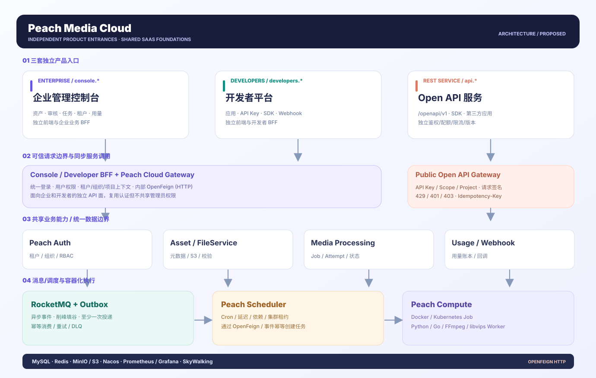

# Peach Media Cloud

> **Status: three-entry interactive HTML/CSS/JavaScript prototype + local mock Open API + proposed technical design. This is not a deployed SaaS backend.**
>
> 中文：[README_zh-CN.md](README_zh-CN.md)

<!-- doc-section:overview -->
## Overview

Peach Media Cloud is a proposed **multi-tenant Digital Asset Management (DAM) and containerized media processing SaaS** for enterprises and third-party developers. The target lifecycle is upload authorization → S3 direct upload and quarantine → malware scanning → queue/backpressure → Docker/Kubernetes media workers → approval and publication → Open API/CDN delivery → webhooks → usage and audit.

The interactive prototype now has **three independent product entry points**, rather than one admin sidebar:

| Entrance | Standalone HTML / HTTP route | Audience and capabilities |
|---|---|---|
| **Enterprise Console** | [`prototype/console/index.html`](prototype/console/index.html) | DAM, uploads, review, jobs, tenant/organization, roles, usage and operations |
| **Developer Platform** | [`prototype/developers/index.html`](prototype/developers/index.html) | Integration apps/environments, API keys, SDK docs, webhooks and API activity |
| **Open API Service** | `/openapi/v1/*`, with [`prototype/openapi/index.html`](prototype/openapi/index.html) for interactive testing | Machine-to-machine REST for uploads, processing jobs, event ingestion and usage |

Start from the [product entrance hub](prototype/index.html). **Open API is an HTTP service, not just a third admin screen**. The explorer is a developer aid.

<!-- doc-section:architecture -->
## Architecture



- **Control plane:** Separate Console/Developer frontends and BFFs plus independent public Open API service; they reuse Peach Cloud Auth, Gateway, tenant, organization, RBAC, assets and usage.
- **Internal synchronous calls:** **Spring Cloud OpenFeign (HTTP)**; asynchronous events use **RocketMQ + Transactional Outbox**, carrying trusted tenant/project context.
- **Scheduler:** Native **Peach Scheduler** owns Cron, delays, dependencies, retries and leases. No separate RPC-based scheduling framework is integrated in this release.
- **Data plane:** Direct-to-S3/MinIO uploads, quarantine/security scanning, CDN and signed URLs. Large file bytes bypass business Gateway.
- **Processing plane:** Peach Compute schedules Docker/Kubernetes Jobs, executed by Python/Go/FFmpeg/libvips workers.

Other editable diagrams: [original platform architecture](docs/architecture/01-platform-overview.svg) · [compute runtime](docs/architecture/02-compute-runtime.svg) · [asset lifecycle](docs/architecture/03-asset-data-loop.svg) · [tenant security](docs/architecture/04-tenant-security.svg). The [concept image](docs/architecture/concept-peach-media.webp) illustrates mood only and is not authoritative topology.

<!-- doc-section:quick-start -->
## Quick start

**Recommended: launch all three entries and the callable local mock API** using Node.js 18+, from the repository root:

```bash
node prototype/mock-server.cjs
```

Open `http://127.0.0.1:8080/` and choose an entry, or navigate directly to:

- `http://127.0.0.1:8080/console/` — Enterprise Console
- `http://127.0.0.1:8080/developers/` — Developer Platform
- `http://127.0.0.1:8080/openapi/` — Open API Explorer; HTTP base is `http://127.0.0.1:8080/openapi/v1`

**Cross-entry demo:** Create a scoped mock key in Developer Platform → paste it in Open API Explorer → run **Complete HTTP flow** → refresh **Open API activity** on the Enterprise Console dashboard → inspect request/activity metrics in Developer Platform. Built-in test credentials are `pm_demo_stellar` (tenant t1) and `pm_demo_lime` (tenant t2).

For a **static UI-only preview**, open [`prototype/index.html`](prototype/index.html) directly or run `python3 -m http.server 8080 --directory prototype`. Static mode does not provide HTTP API calls or the cross-entry mock feedback loop.

Run tests without npm dependencies:

```bash
node --test tests/*.test.cjs
node tests/validate-static.mjs
node --check prototype/app.js
node --check prototype/developers/developer.js
node --check prototype/openapi/explorer.js
```

<!-- doc-section:documents -->
## Documentation

| Document | Contents |
|---|---|
| [Product PRD (Chinese)](docs/product/PRD_zh-CN.md) | FR-001–FR-136 plus FR-137–FR-144 for separate entrances, modules, workflows, acceptance |
| [Technical design](docs/architecture/TECHNICAL_DESIGN.md) | Three gateways/BFFs, OpenFeign, scheduler, data/compute planes |
| [API contract](docs/architecture/API_CONTRACT.md) | REST endpoints, auth, idempotency, errors, events |
| [Worker protocol](docs/architecture/WORKER_PROTOCOL.md) | Docker/K8s and Python/Go Job/Attempt/Runtime contracts |
| [Acceptance matrix](docs/product/ACCEPTANCE_MATRIX.md) | Independence, multi-tenancy, cross-entry flows and fault recovery |
| [DESIGN.md](DESIGN.md) · [UX-CONTRACT.md](UX-CONTRACT.md) | Shared tokens, navigation and interaction rules |

<!-- doc-section:structure -->
## Repository layout

```text
Peach-Media/
├── prototype/
│   ├── index.html                # Entrance hub
│   ├── console/index.html        # Standalone Enterprise Console
│   ├── developers/index.html     # Standalone Developer Platform
│   ├── developers/developer.js   # Developer interactions
│   ├── openapi/index.html        # API Explorer interface
│   ├── openapi/explorer.js       # HTTP request/response and full demo flow
│   ├── mock-server.cjs           # Built-in Node HTTP mock
│   ├── tokens.css               # Shared brand tokens
│   ├── portal.css               # Hub/Developer/API UI styles
│   ├── styles.css               # Enterprise Console styles
│   ├── core.js                  # Pure demo domain functions
│   └── app.js                   # Enterprise operations (22 routes)
├── docs/product/                # Requirements and acceptance
├── docs/architecture/           # Contracts, architecture and editable SVGs
├── scripts/                     # Diagram generators
├── tests/                       # Built-in Node tests
├── DESIGN.md
└── UX-CONTRACT.md
```

<!-- doc-section:limitations -->
## Prototype limitations

- **Mock binds to `127.0.0.1` only. Never expose it publicly.** `/demo/v1/*` intentionally bypasses real login to support local exploration. Demo tokens and scopes are not production-grade security.
- Upload completion creates mock asset metadata only; no real file bytes, FFmpeg, Docker, Kubernetes, or outbound webhooks are used.
- The enterprise console retains browser `localStorage` state, while Open API key/activity/new job data is kept in the Node mock process memory and is lost on restart. Its dashboard can pull those mock records; this is **not production transactional consistency**.
- Production requires separately deployable frontends/BFFs, an independently scalable public API and server-enforced auth, real MQ/object storage, billing and compute services.
- Proposed integration sequence: Peach Cloud → OpenFeign + RocketMQ → native Peach Scheduler → Peach Compute/Runtime SPI. Audit the actual Peach Cloud code before backend work begins.

<!-- doc-section:references -->
## Technology references

[Cloudinary](https://cloudinary.com/documentation) · [ImageKit](https://imagekit.io/docs) · [Uploadcare](https://uploadcare.com/docs/) · [Mux](https://www.mux.com/docs) · [Kubernetes Jobs](https://kubernetes.io/docs/concepts/workloads/controllers/job/) · [Docker security](https://docs.docker.com/engine/security/).
