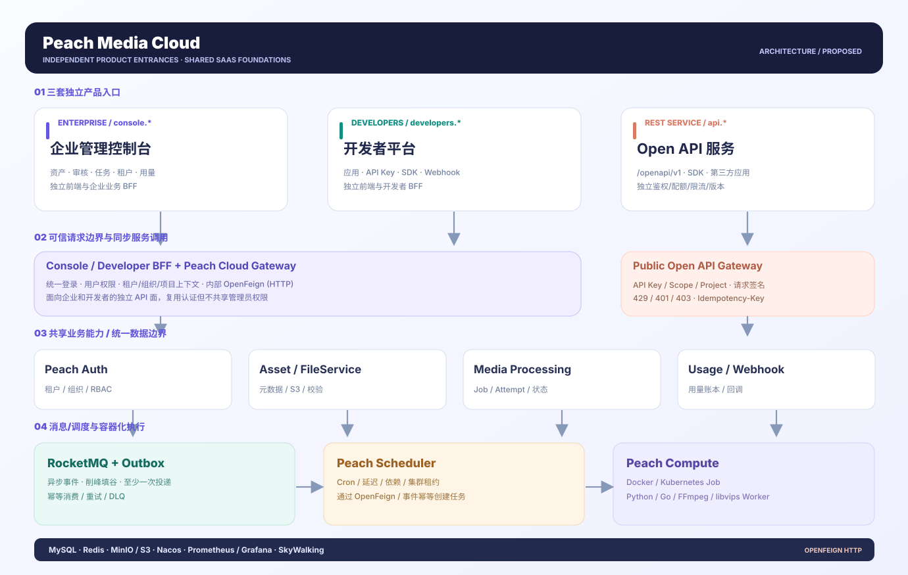

# Peach Media Cloud

> **当前状态：三入口 HTML/CSS/JavaScript 交互原型 + 本地 Mock Open API + 拟实施技术方案；不是已上线的 SaaS 后端。**
>
> English: [README.md](README.md)

<!-- doc-section:overview -->
## 产品概览

Peach Media Cloud 计划建设为面向企业和第三方开发者的**多租户数字资产管理（DAM）与容器化媒体处理 SaaS**。核心数据闭环为：上传申请 → S3 直传与隔离 → 安全扫描 → 消息削峰 → Docker/Kubernetes Worker 处理 → 审核发布 → Open API/CDN 分发 → Webhook 通知 → 用量与审计。

本次原型已经划分为**三套独立入口**，不再将所有功能置于一个管理后台的菜单中：

| 入口 | 独立页面 / HTTP 服务 | 目标用户与核心能力 |
|---|---|---|
| **企业管理控制台** | [`prototype/console/index.html`](prototype/console/index.html) | DAM、上传、媒体任务、审核、组织、角色、租户、用量 |
| **开发者平台** | [`prototype/developers/index.html`](prototype/developers/index.html) | 接入应用、环境、API Key、SDK、Webhook、调用日志 |
| **Open API 服务** | `/openapi/v1/*`，附带 [`prototype/openapi/index.html`](prototype/openapi/index.html) 接口调试器 | 第三方系统使用 HTTPS REST 上传、提交任务、上报事件和查询用量 |

完整的入口导航位于 [`prototype/index.html`](prototype/index.html)。Open API 是 HTTP 服务，而非第三个后台页面；调试器只是辅助开发者体验。

<!-- doc-section:architecture -->
## 架构概览



- **控制面**：企业 Console/Developer BFF 与 Open API 服务分别部署，复用 Peach Cloud 的 Auth、Gateway、租户、组织、RBAC、资产、配置与用量基础能力。
- **内部同步调用**：**Spring Cloud OpenFeign（HTTP）**；异步事件采用 **RocketMQ + Transactional Outbox**，按租户/项目传递可信上下文。
- **定时调度**：**Peach Scheduler** 独立管理 Cron、延迟、依赖、重试和租约；本期不集成外部 RPC 调度平台。
- **文件数据面**：S3/MinIO 直传、隔离区、安全扫描、CDN/签名链接，避免大文件通过 Gateway 传输。
- **计算面**：Peach Compute 调度 Docker / Kubernetes Job，Python/Go/FFmpeg/libvips Worker 执行实际媒体处理。

其他可编辑 SVG：[原始平台架构](docs/architecture/01-platform-overview.svg) · [计算运行时](docs/architecture/02-compute-runtime.svg) · [资产闭环](docs/architecture/03-asset-data-loop.svg) · [租户权限](docs/architecture/04-tenant-security.svg)。[概念视觉稿](docs/architecture/concept-peach-media.webp)仅用于风格参考，不是权威拓扑。

<!-- doc-section:quick-start -->
## 快速启动

**推荐：一条命令启动全部三个入口与本地可调用 Mock API。** 使用 Node.js 18+，在仓库根目录执行：

```bash
node prototype/mock-server.cjs
```

打开 `http://127.0.0.1:8080/` 选择入口，或直接访问：

- `http://127.0.0.1:8080/console/` — 企业管理控制台
- `http://127.0.0.1:8080/developers/` — 开发者平台
- `http://127.0.0.1:8080/openapi/` — Open API 调试器；API Base URL 为 `http://127.0.0.1:8080/openapi/v1`

**演示协作流程：** 在开发者平台生成具有 `uploads:write`、`jobs:create`、`events:write` 等 Scope 的演示 Key → 在 Open API 调试器粘贴密钥 → 点击「运行完整 HTTP 演示」→ 在企业控制台首页点击「同步 API 活动」→ 回到开发者平台查看调用日志和用量。也可使用内置测试凭证 `pm_demo_stellar`（租户 t1）和 `pm_demo_lime`（t2）。

如果只想看界面，也可直接打开 [`prototype/index.html`](prototype/index.html) 或运行 `python3 -m http.server 8080 --directory prototype`，但在**静态模式**下 Open API HTTP 请求不可用，不能体验真正的跨入口 Mock 联动。

验证命令（无 npm 依赖安装）：

```bash
node --test tests/*.test.cjs
node tests/validate-static.mjs
node --check prototype/app.js
node --check prototype/developers/developer.js
node --check prototype/openapi/explorer.js
```

<!-- doc-section:documents -->
## 文档索引

| 文档 | 内容 |
|---|---|
| [详细 PRD（中文）](docs/product/PRD_zh-CN.md) | 原有 FR-001～FR-136 + 三入口 FR-137～FR-144、模块、流程、实施与验收 |
| [技术设计](docs/architecture/TECHNICAL_DESIGN.md) | 三入口/BFF/独立 API、OpenFeign、调度、数据面与计算面 |
| [API 合同](docs/architecture/API_CONTRACT.md) | REST API、认证、幂等、错误与事件规范 |
| [Worker 协议](docs/architecture/WORKER_PROTOCOL.md) | Docker/K8s 与 Python/Go 的 Job/Attempt/Runtime 合同 |
| [验收矩阵](docs/product/ACCEPTANCE_MATRIX.md) | 独立性、多租户、跨入口联动、故障与数据一致性验证 |
| [DESIGN.md](DESIGN.md) · [UX-CONTRACT.md](UX-CONTRACT.md) | 统一 Design Token、跨产品交互规范 |

<!-- doc-section:structure -->
## 项目结构

```text
Peach-Media/
├── prototype/
│   ├── index.html                # 三入口产品导航
│   ├── console/index.html        # 企业控制台（独立入口）
│   ├── developers/index.html     # 开发者平台（独立入口）
│   ├── developers/developer.js   # 开发者平台交互
│   ├── openapi/index.html        # HTTP Open API 调试器
│   ├── openapi/explorer.js       # 请求/响应/一键完整数据流
│   ├── mock-server.cjs           # Node.js 原生 HTTP Mock API
│   ├── tokens.css               # 三入口共享品牌 Token
│   ├── portal.css               # Hub/Developer/API 样式
│   ├── styles.css               # 企业控制台样式
│   ├── core.js                  # 演示领域模型
│   └── app.js                   # 企业控制台 22 个业务页面
├── docs/product/                # PRD 与验收
├── docs/architecture/           # 协议、技术文档及可编辑 SVG
├── scripts/                     # 架构图生成脚本
├── tests/                       # Node 原生测试
├── DESIGN.md
└── UX-CONTRACT.md
```

<!-- doc-section:limitations -->
## 原型边界与实施限制

- **Node Mock 只监听 `127.0.0.1`，不可暴露公网**；`/demo/v1/*` 是故意简化的无真实登录模拟接口。HTTP API 有演示令牌和 Scope 检查，但**不具备生产安全强度**。
- API 的上传 Complete 仅创建模拟资产数据，不接受真实字节；视频任务不会执行 FFmpeg、Docker 或 K8s；Webhook 不进行真实网络投递。
- 企业控制台原有页面数据保存在浏览器 `localStorage`；Open API 的调用/密钥/创建任务保存在本地 Node 进程内存中，重启会丢失。首页可从 Mock API 同步新增资产/任务/活动，**不代表生产级事务一致性**。
- 当前三入口为原生 HTML 独立文件；生产版本需要各自前端构建、BFF/Gateway 和统一后端授权；没有真实认证、消息队列、对象存储、计费或容器编排集成。
- 后续开发继续遵循：Peach Cloud → OpenFeign + RocketMQ → Peach Scheduler → Peach Compute/Runtime SPI。应审计 Peach Cloud 的真实可用代码和 CI，再开始业务后端实施。

<!-- doc-section:references -->
## 技术参考

[Cloudinary](https://cloudinary.com/documentation) · [ImageKit](https://imagekit.io/docs) · [Uploadcare](https://uploadcare.com/docs/) · [Mux](https://www.mux.com/docs) · [Kubernetes Job](https://kubernetes.io/docs/concepts/workloads/controllers/job/) · [Docker 安全](https://docs.docker.com/engine/security/)。
