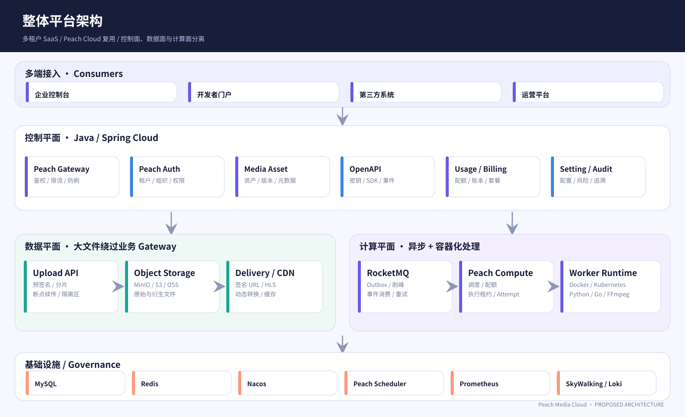
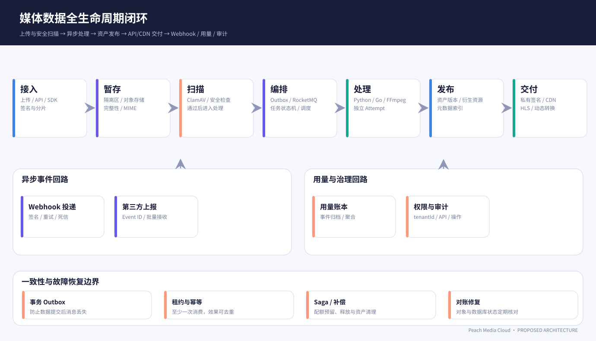
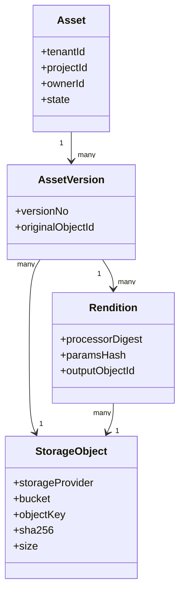
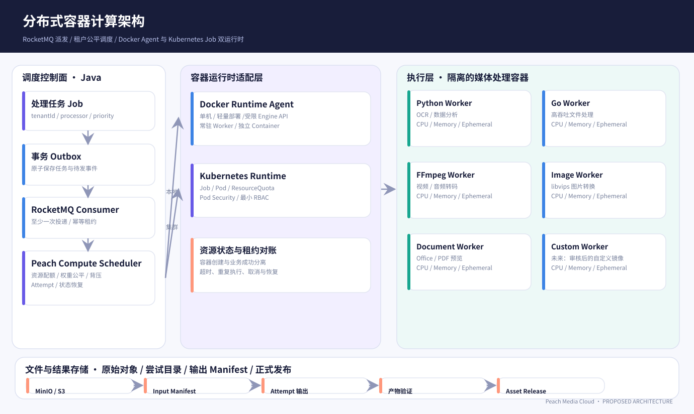
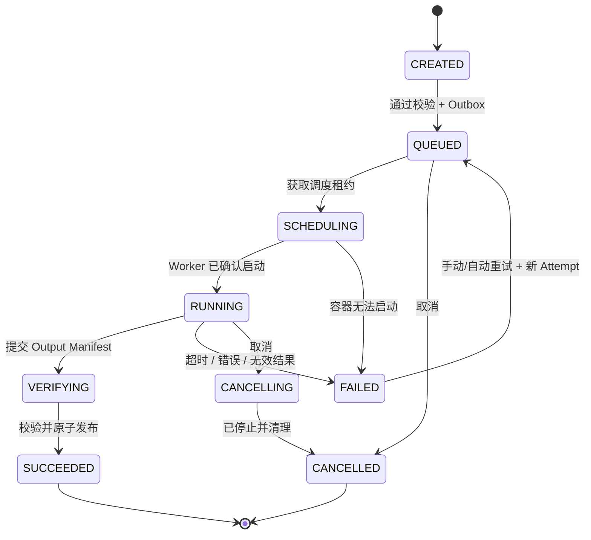
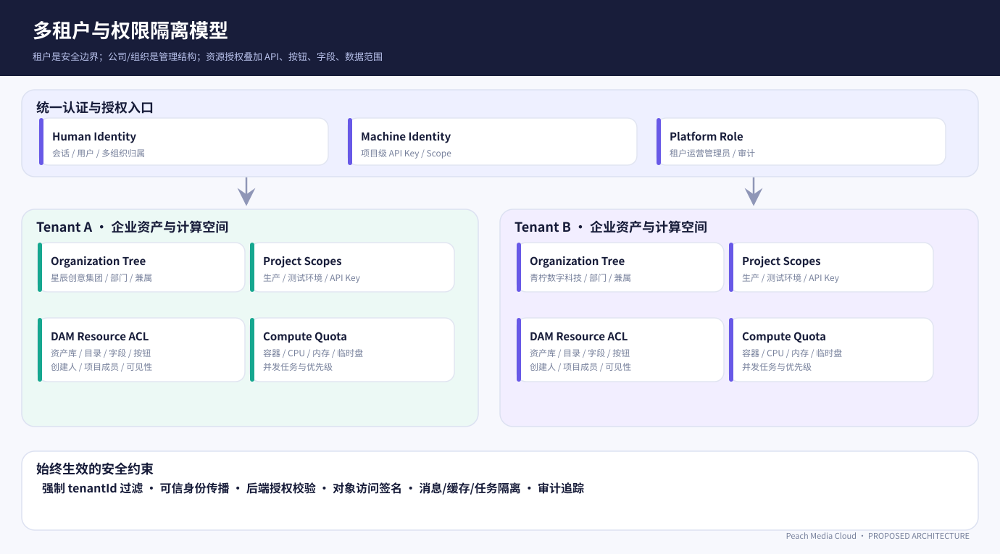

# Peach Media Cloud — 技术架构与实施设计（Proposed）

> 版本 V1.0 · 2026-11-06 · 这是**拟实施技术方案**，不是实际已运行的微服务源码。完整业务需求见 [PRD](../product/PRD_zh-CN.md)。

## 1. 核心设计判断

- **基础平台复用**：Peach Cloud 承担认证/租户/权限/网关/基础 FileService/配置/消息/监控；Peach Media 是独立媒体业务域。现有 peach-cloud 代码的真实完成情况需要在实施前核验。
- **三平面**：Java 控制面处理业务；对象存储 + CDN 作为数据面；Peach Compute + OCI Worker 作为计算面。媒体 GB 级字节流不经 Gateway 转发。
- **对象与资产解耦**：Asset 代表业务资源，Object 代表物理对象，Rendition 代表衍生处理产物；多租户权限在资产层及下载签名层同时执行。
- **任务投递与执行**：MySQL 本地事务 + Outbox → RocketMQ → 资源调度 → Docker/K8s → Worker Manifest → 验证 → 发布。仅提供至少一次投递语义，业务效果以幂等保障。
- **双 Runtime**：Docker Agent 用于个人开发/单机运行，Kubernetes Job 用于分布式生产。Kubernetes 节点通常使用 containerd/CRI-O，DockerRuntime 不等于 K8s 节点运行时。
- **任务调度分工**：OTRYX Flow 负责任务计划/依赖编排的候选集成；Peach Compute 负责每次容器计算执行。先验证 Flow 的真实可用 API 和版本再决定接入方式。
- **不可信文件处理**：ClamAV 与 MIME 真实校验、隔离区、处理器白名单、网络和文件系统隔离；用户自定义容器属于后期高风险功能。



## 2. 控制面和微服务职责

| 服务 | 主要 API | 核心数据 | 可靠性边界 |
|---|---|---|---|
| Auth | 会话、租户、组织、角色、权限评估 | User/Org/Role/Binding | 策略变更触发缓存失效，敏感操作拒绝优先 |
| Asset | Asset/Version/Folder/Metadata/ACL | `media_asset*` | 资源级授权，状态机原子推进 |
| FileService | UploadSession、Complete、Storage、Scan | `media_upload_*`, `media_storage_*` | 完整性校验，安全扫描失败不能发布 |
| Processing | Job、Pipeline、Attempt、Transform | `media_job_*`, `media_pipeline*` | Outbox 事务、状态 CAS、重复提交去重 |
| Compute | Processor Registry、租约、Runtime、资源 | `media_processor*`, runtime status | 核对 DB 目标与真实容器状态 |
| Delivery | 签名 URL、策略、CDN Purge | policy/share/access | 资产/版权/租户授权都必须过关 |
| OpenAPI | Project/API Key/Idempotency/SDK 合同 | credential/idempotency | 密钥摘要存储，定量速率限制 |
| Webhook | Endpoint、Delivery、Retry/Dead Letter | webhook tables | 网络不稳定，至少一次投递、签名防重放 |
| Usage | Reserve/Commit/Release、Ledger/Aggregate | quota/usage tables | 不可变凭据、去重、可重算 |
| Monitor/Scheduler | 技术监控、周期任务触发 | metrics/schedule | 计划触发不表示业务执行成功 |

每个业务服务拥有自己的逻辑数据表与变更事务边界，不能跨微服务共享未授权数据库连接。关键业务通过事件或服务 API 交互；不建议让 Gateway 访问业务数据库。

## 3. 文件和资产完整链路



### 3.1 上传会话与直传

1. 验证登录/Key、tenant/project/asset 上传 Scope 与当前额度。
2. `transaction { INSERT upload_session; INSERT quota_reservation; INSERT outbox; }` 返回会话和过期时间。
3. 根据大小与 StorageProvider capability 选择单对象上传或 MPU；签发限期短时 URL，不泄露 S3 长期密钥。
4. 客户端直传对象存储。Complete 使用客户端返回的分片编号/ETag，服务端查询对象实际元数据。
5. 上传 Complete 的幂等键必须绑定 tenantId + projectId + uploadId + 请求摘要，重复 Complete 不得创建新 Asset。
6. 状态 `CREATED → UPLOADING → COMPLETING → QUARANTINED → SCANNING → READY | REJECTED | ERROR`。
7. 扫描失败时保持隔离，不授予公开下载；扫描通过后可转到处理中或者发布原文件。
8. 回收未完成 MPU 的 Scheduler 不能误删正在上传的活跃会话；需租约/延时判定。

### 3.2 文件对象关系



- Object 生命周期不与 Asset 同步删除；每个对象引用检查必须在授权租户范围内。
- 产物缓存命中必须同时验证当前使用方有权复用衍生物；共享底层对象不意味着共享访问凭证。
- 高并发下载优先走 CDN/对象存储，不通过 Spring MVC 代理字节流；必要的私有下载可采用受限短期签名、范围请求和审计入口。

## 4. Peach Compute 容器化计算引擎



### 4.1 运行模式

| 模式 | 业务类型 | 计算特性 | 扩缩容 |
|---|---|---|---|
| 常驻 Worker Pool | 缩略图、Hash、轻量图像、事件清洗 | 容器常驻、高吞吐、有界消费 | 队列深度/并发/CPU 指标，支持 KEDA/HPA |
| 独立 Job/Container | 长视频、长时 Python、Office、重型数据作业 | 单次执行隔离、资源 Profile、超时 | 并发预算 + Job Controller |
| 自定义镜像（P2） | 审核通过的企业处理器 | 高安全与合规门槛 | 独立命名空间/沙箱策略 |

### 4.2 调度与公平性

Job 调度请求不包含任何文件字节，只包含 `tenantId`, `projectId`, `processorCode`, `processorDigest`, `assetVersionId`, `priority`, `resourceProfile`, `idempotencyKey`, `inputManifestRef`。

- 使用 **globalBudget** 控制整个集群 CPU/Memory/EphemeralStorage/执行并发，使用 **tenantBudget** 和 **projectBudget** 避免单租户占用全部计算资源。
- 采用带权公平队列或 Deficit Round Robin；队列长度有限，超出时明确返回拒绝/等待并审计。
- Compute 创建资源必须先拿 DB 租约（含 fencing token），重复 MQ 事件无法获得同一生效的执行租约。
- Kubernetes Job 对 API 返回 201 只表示资源已创建；须 Watch Job/Pod 观察实际 Ready/Running/Succeeded/Failed，Worker 输出 Manifest 仍是业务成功的必要条件。
- 任务停止：先写 `desired_state=CANCELLED`，再通知 Worker、发 K8s/Docker Stop，等待归档并释放额度；取消对外呈现为“处理中/已取消”而非瞬时成功。
- Worker 出口网络默认只允许对象存储、任务控制 API、必要 DNS；容器只挂只读任务凭据/临时盘，不挂宿主机路径或 Docker Socket。

### 4.3 幂等与 Attempt



`Attempt` 使用 `attemptId`, `attemptNo`, `fencingToken`, `runtimeTaskId`, `startedAt`, `heartbeatAt`, `finishedAt`, `exitCode`, `outputManifestRef`。输出路径隔离为 `processing/{jobId}/{attemptId}/`，旧 Attempt 不能覆盖新结果。`Job` 与 `RuntimeTask` 状态分别存储；对账控制器处理悬空 Job、失联容器、错误终态。

### 4.4 Runtime SPI 与 Worker SDK

具体请求响应和错误码见 [Worker Protocol](WORKER_PROTOCOL.md)。推荐 Java 抽象：

```java
public interface ContainerRuntime {
    RuntimeTask create(RuntimeSpec spec);
    RuntimeTaskStatus status(String runtimeTaskId);
    void stop(String runtimeTaskId);
    RuntimeLogs logs(String runtimeTaskId);
    void delete(String runtimeTaskId);
}
```

注意：此接口是**建议设计**，不是 peach-cloud 当前已存在的接口。实际实现建议 `create` 采用幂等操作，`start` 取决于 Docker/K8s 资源是否在创建后直接启动，不能假定所有 Runtime 具有完全相同的同步语义。调度与运行时适配器之间的状态模型应独立清晰定义。

## 5. 分布式事务与一致性

### 5.1 本地事务与 Outbox

`Media Job` 创建：单个 MySQL 本地事务同时提交 Job、Quota Reservation、Outbox。Outbox Relay 安全地把事件发送 RocketMQ，发送成功后标记已发布；重启后可能重复发送，消费者去重。不能在 `@Transactional` 内直接依赖 MQ 发送的成功与否获得跨系统原子性。

### 5.2 Saga 补偿表

| 业务 | 正向动作 | 补偿动作 | 幂等证据 |
|---|---|---|---|
| 大文件上传 | 预留额度、创建 MPU | Abort MPU、释放额度、过期清理 | uploadId + reservationId |
| 转码 | 申请计算额度、创建 Attempt | 标记失败、删除临时产物、释放预算 | jobId + attemptId |
| 资产发布 | 校验 Output、登记 Rendition | 失败保持 Verify/Repair，不公开交付 | outputDigest + publishVersion |
| 资产删除 | 撤销签名、标记 DELETING | 延迟清理与重试；不可逆阶段禁止回滚 READY | deleteOperationId |
| Webhook 交付 | 建立 delivery attempt、发送 | 不回滚业务，只在投递子流程重试/死信 | eventId + endpointId |
| 用量结算 | Reserve → Commit | 未实际运行的资源释放，不允许重复扣费 | usageEventId / reservationId |

对外接口需区分 `ACCEPTED`（受理）、`RUNNING`（执行）、`READY/SUCCEEDED`（业务成功）与 `NEEDS_REPAIR`（一致性待修复），不可提前宣布完成。

## 6. 多租户权限和数据安全



**权限组合：** TenantBoundary（不可覆盖） ∩ ProjectScope ∩ ResourceRelation ∩ ActionPermission ∩ FieldPolicy ∩ BusinessStateGuard。任何一维拒绝即拒绝。一个用户可能属于多个组织，组织可以是行政组织、项目组或自定义类型；用户与组织的多对多关系不等于授权天然扩展。

权限使用统一资源编码：`asset:read`, `asset:upload`, `asset:update`, `asset:publish`, `asset:delete`, `job:create`, `job:cancel`, `key:create`, `webhook:manage`, `usage:read`, `tenant:manage`。前端按钮只改变展示，后端真实授权不可缺失。

- 外部 API Key 必须具 tenant/project/env/scope 和撤销策略；公钥仅能申请受限上传策略。
- CDN/媒体签名包含对象版本、变换参数、作用域和到期时间；撤销后缓存不应继续暴露私有资产。
- Worker 不持有企业管理员 Token，通过短期 Job Credential 获取指定对象/结果目录的最小权限。
- Webhook URL 存在 SSRF 风险，必须使用 HTTPS、目标域名验证、重定向禁止/限制、IP/CIDR 校验，不能访问内网元数据和本地回环地址。
- 日志、错误体、审计中禁止包含 Secret Key、签名 Query 或媒体原始敏感内容。

## 7. Open API 与媒体交付

- 控制面写操作必须有 Idempotency-Key（敏感高成本写入和 Complete 强制）；使用标准 JSON 的错误结构。
- 资产处理异步受理返回 HTTP 202 + Job Location；客户端可以轮询但更推荐 Webhook。
- Transformation URL 必须做资源授权、预设参数白名单、尺寸上限、并发预算和缓存键规范化，避免请求携带超大宽高或任意 filter 导致 CPU 滥用。
- 公有资产可使用 CDN；私有资产默认私有，交付 URL 使用签名，缓存键/回源校验与租户隔离一并验证。
- API/SDK 和 webhook 事件版本化；Webhook 通过 HMAC + timestamp + eventId 提供验签和防重放建议。

## 8. 指标、审计、运维与恢复

**技术指标：** gateway_request_duration_ms、api_auth_error_total、upload_complete_total、upload_part_retry_total、scan_reject_total、outbox_pending、rocketmq_lag、compute_queued_jobs、compute_worker_capacity、runtime_job_start_duration、worker_heartbeat_age、job_retry_total、webhook_delivery_retries、storage_orphan_candidates、quota_reserved_cpu。

**业务指标：** tenant_active_assets、asset_download_total、media_transcode_minutes、storage_byte_days、api_key_calls、cdn_egress_bytes、quota_reservations、usage_ledger_discrepancy。

统一 Tag：`tenantId`、`projectId`、`traceId`、`jobId`、`attemptId`。Prometheus 高基数标签必须谨慎，例如 jobId 不应作为常规 Metrics 标签而应进入 Trace/Log，避免时序爆炸。

故障恢复遵循：重试有上限/退避、死信可查看、对账可恢复、审计留痕、回调无副作用重复执行、已完成的业务不因后续通知失败而回滚。

## 9. 开发与部署计划

1. **单机开发基线**：peach-cloud 核心服务 + MySQL + Redis + RocketMQ + MinIO + Docker Runtime Agent + FFmpeg/Go/Python Worker 的受限 Compose 组合。
2. **业务边界稳定后**：ContainerRuntime 接 K8s Job，部署计算池、资源配额、Pod Security 和 Secret 管理，不改变 Job/Attempt/Worker 协议。
3. **容量达到阈值再扩展**：KEDA/HPA、OpenSearch、ClickHouse、多区域存储、多 CDN、自定义处理器沙箱。不要先引入全套复杂中间件。
4. **CI 先本地静态/合同/单元测试，合并门禁批量运行**：不要每个微小改动都触发全量昂贵 CI；重要功能完成后集中执行集成与故障测试。

## 10. 测试与验收依据

- 正常流程：租户登录 → 项目 → Upload → Scan → Media Process → Asset Ready → Delivery → Webhook → Usage Ledger。
- 异常流程：断点续传、重复 Complete、重复 MQ 投递、K8s Job 重启、Worker OOM、Webhook 超时、跨租户 ID、限流 429、配额不足、存储不可用与对象丢失。
- 数据安全：RBAC/ABAC、批量授权、链接撤销、跨项目资源、镜像签名、Docker Agent 最小权限与 K8s 网络策略。
- 更多验收用例见 [ACCEPTANCE_MATRIX](../product/ACCEPTANCE_MATRIX.md)，接口合同见 [API_CONTRACT](API_CONTRACT.md)。

## 11. 精确架构图与生成式视觉稿的区别

本目录 `01-` 到 `04-` 开头的 SVG 是**可编辑、可复查的规范示意图**，并由 `scripts/render_architecture.py` 重建；图片 `concept-*.webp` 为生成式视觉参考，仅作 UI/产品风格讨论，**不作为节点名称、流向和部署事实的唯一依据**。
