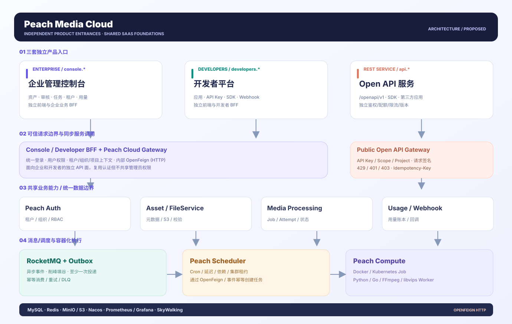
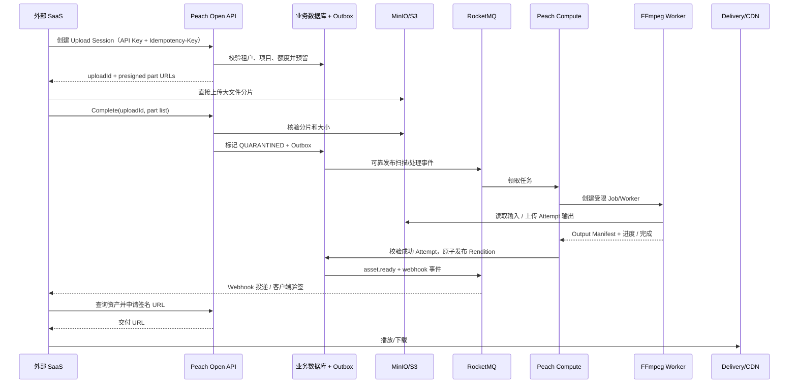
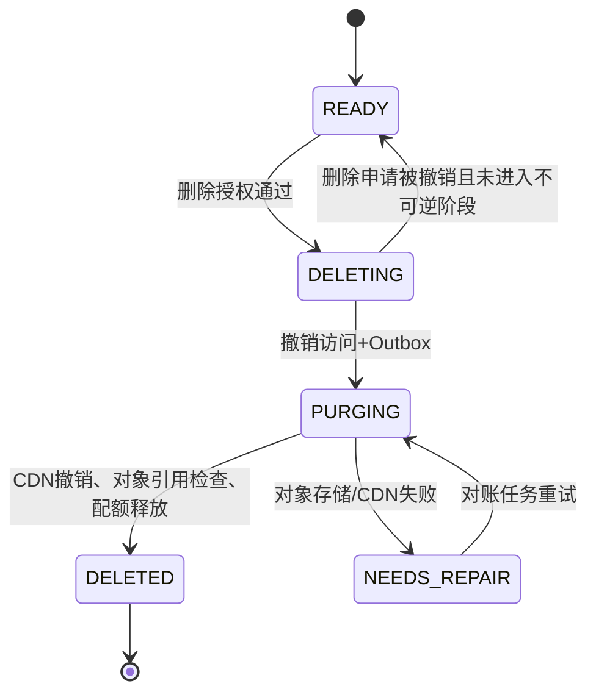
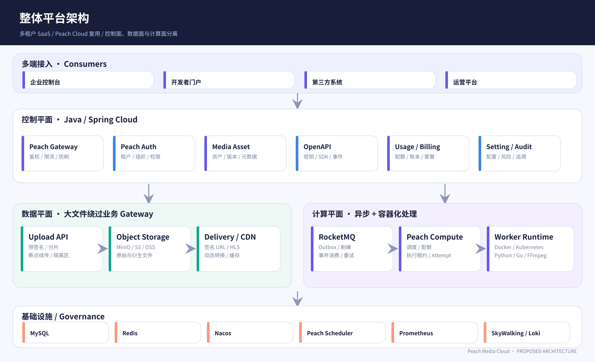

# Peach Media Cloud — 企业级数字资产与容器化媒体处理 SaaS 产品需求文档

> 版本：V1.0 需求基线（2026-11-06） · 状态：**规划 / Proposed** · 适用对象：产品、前端、Java 后端、Python/Go Worker、测试、部署运维
>
> **重要区分：** 当前 `Peach-Media` 仓库交付的是 HTML/CSS/JS 可点击的**离线交互原型**和**实施需求**，并没有真实后端、对象存储、RocketMQ、Docker/Kubernetes 执行功能。本文全部“必须支持”均表示**目标产品需求**，不可误读为已完成能力。原型中的数值与任务状态是演示数据。

## 0. 需求摘要与产品边界

Peach Media Cloud 定位为**面向企业内容团队、开发者和第三方 SaaS 的多租户数字资产管理（DAM）与容器化媒体/数据处理平台**，不是网盘，也不是视频编辑器。用户从控制台、SDK 和 Open API 上传资产，平台进行多云存储、隔离扫描、元数据管理、容器化异步处理、审核、授权交付、Webhook 回调与用量核算，形成完整的数据闭环。

核心技术目标是复用 **peach-cloud** 的 Gateway、Auth、Setting、FileService、Message、Monitor、Generator、Nacos、Redis、MySQL、RocketMQ 和既有可观测性能力。媒体业务代码隔离在 Peach Media 业务域，计算执行抽象为 Peach Compute；本期**不集成 外部 RPC 框架**：内部同步服务调用采用 Spring Cloud OpenFeign；周期性触发由 Peach Scheduler 独立实现，处理作业仍由 Peach Compute 管理。

### 0.5 三套相互独立、协同工作的产品入口（FR-137 ~ FR-144）

**决定：** 三入口属于同一 SaaS，但不是同一个后台的三个菜单组。未来生产部署需要独立构建、独立发布和可独立扩缩容；共享同一身份/租户/项目资源模型，不能共享彼此的前端管理员权限。当前 HTML 原型以不同静态 HTML 文档演示三个入口；本地 Node Mock API 提供可请求的独立 HTTP 接口。

| 入口 | 未来推荐域名/路径（拟议） | 主要用户 | 独立交付 | 可以访问的能力 |
|---|---|---|---|---|
| 企业管理控制台 | `console.<your-domain>` | 租户管理员、内容团队、运营/审计 | Enterprise Console 静态应用 + 业务 BFF | DAM、审核、文件、媒体任务、资源治理、权限、配额、用量 |
| 开发者平台 | `developers.<your-domain>` | SDK/API 接入人员 | Developer Portal 静态应用 + Developer BFF | 接入应用、环境、Scope、密钥、Webhook、SDK、调试记录 |
| Open API 服务 | `api.<your-domain>/openapi/v1` | 第三方应用/机器身份 | 独立 Gateway/OpenAPI Service（HTTP） | 上传会话、Asset/Job、交付、事件上报、用量；示例调试器仅为开发者工具 |

| ID | 功能需求 | 必须满足的行为与权限边界 | 验收方式 |
|---|---|---|---|
| FR-137 | 三入口独立部署 | 控制台与开发者平台分别打包；Open API 单独扩缩容，不把 REST 接口当后台页面 | 独立构建并验证每个域名/路径 |
| FR-138 | 企业控制台领域隔离 | 不再以菜单混放 API Key/Webhook/开发者文档，允许明确跳转开发者平台 | 侧栏权限、菜单入口与跳转 E2E |
| FR-139 | 开发者工作空间 | 接入项目、环境、凭证、Scope、Webhook、SDK 示例、调用审计与用量 | 凭证生成/轮换/撤销、Webhook 流程 |
| FR-140 | 独立开放 API | 版本化 HTTPS REST，按服务端可信 API Key 解析 tenant/project/env/scope，错误与 202 语义稳定 | 未授权 401、无 Scope 403、跨租户 404、异步返回 202 |
| FR-141 | 跨入口数据闭环 | 开发者创建 Key → 外部创建上传/Job/事件 → 控制台看见资产、任务、事件和用量 | 集成 E2E 跨入口数据一致性验证 |
| FR-142 | 内部通信标准 | Spring Cloud OpenFeign 处理同步服务调用，RocketMQ 处理异步事件，不引入 外部 RPC 框架 | 服务接口、租户上下文、超时/重试/隔离契约 |
| FR-143 | 内置定时调度 | Peach Scheduler 独立持久化 Cron/延迟/依赖触发；通过幂等 HTTP/API 或消息创建任务 | 多实例触发、重复/故障/失联恢复测试 |
| FR-144 | 可运行三入口原型 | 独立页面及本地 Mock API；静态模式只能预览，Node 模式支持真实 HTTP 数据模拟闭环 | 三页面路由 + Mock API 集成自动化检查 |

**明确排除：** 本期不依赖 外部 RPC 调度组件，也不通过 外部 RPC 框架 实现 Peach Media 服务调用。接口标准以 OpenFeign + HTTP REST、RocketMQ 异步消息为准。模拟 HTTP Server 只监听 127.0.0.1，不是生产 API 实现。



### 0.1 设计原则

1. **SaaS 优先、私有化可部署**：同一产品模型支持多租户 SaaS；独立部署不应破坏租户模型。第一期共享库/共享 Schema，数据库记录强制租户隔离，预留独立数据库适配。
2. **API-first**：控制台与 SDK 均建立在受版本管理的 API 合同之上；第三方系统可以完整使用核心业务。
3. **控制面 / 数据面 / 处理面分离**：大文件字节流不穿过业务网关；CPU 密集任务在容器独立执行，Java 负责业务和调度。
4. **事件驱动、可补偿**：不可跨 MySQL/MQ/S3/K8s 假装一个全局原子事务，必须使用 Outbox、幂等、Saga、重试与对账。
5. **隔离优先**：租户强隔离，组织与项目范围在租户内生效，字段/按钮/资源级操作在后端校验。
6. **先正确再扩容**：优先完成文件可恢复上传、任务状态可靠性、计费账本与失败补偿，再追求高并发和大规模集群。
7. **可替换生态**：存储 SPI（S3/OSS/COS/OBS/R2）、Runtime SPI（Docker/K8s）、Worker 协议（Python/Go/FFmpeg/文档）与开放事件均可扩展。

### 0.2 目标用户与角色

| 角色 | 业务目标 | 典型操作 | 默认数据范围 |
|---|---|---|---|
| 平台超级管理员 | 运营与保障整个 SaaS | 租户管理、套餐、资源池、审计 | 平台管理 API；业务数据不可默认读取 |
| 租户管理员 | 管理企业空间 | 组织、用户、角色、项目、存储策略 | 当前租户全部授权资源 |
| 内容管理员 | 维护企业资产 | 资产库、元数据、版权、审核发布 | 授权资产库、目录和项目 |
| 内容编辑/设计师 | 管理素材及衍生资源 | 上传、编辑、发起处理、版本管理 | 自己/团队负责资源 |
| 审核人员 | 执行媒体审核和发布 | 审核、拒绝、归档、版权核查 | 授权待审资产 |
| 开发者 | 接入 API、Webhook、SDK | API Key、项目环境、任务查询 | 授权项目/环境 |
| 运营/财务 | 处理用量与成本 | 用量账本、配额、套餐、报表 | 被授权的业务和账务范围 |
| 审计人员 | 审核敏感操作 | 授权访问日志、权限变更历史 | 只读授权范围 |
| 计算 Worker | 完成单次任务 | 下载输入、执行处理、提交 Manifest | 任务级短期最小权限，不继承人的角色 |
| 外部系统调用方 | 嵌入资产服务 | 创建上传、提交任务、查询/订阅结果 | API Key 的 tenant/project/scope 交集 |

### 0.3 产品边界与非目标

**本期目标：** 企业控制台、租户/组织/权限、项目/环境、资产与元数据、文件上传/版本/隔离扫描、媒体处理、运行时调度、Open API/Webhook、媒体分发、数据事件、配额账本、报表、审计、监控和可部署体系。

**明确非目标：** 自建全球 CDN、实时直播 CDN、自研对象存储底层、自研数据库、全功能视频编辑器、用户任意不可信镜像直接执行、商业支付通道、AI 生成图片/视频市场。上述可在产品成熟后作为独立议题扩展，不阻塞完整的数据闭环。

### 0.4 验收成功定义

- 至少三个模拟/测试租户可同时存在，跨租户资源 ID 猜测、API Key 换租户、消息/文件/任务关联越界均必须被拒绝并可审计。
- 独立外部调用方能完成：申请上传 → 直传 → Complete → 查询扫描 → 创建处理 → 获取发布结果 → 签名访问 → 接收 Webhook → 查看用量。
- 任务遇到容器创建失败、进程退出、重试、重复投递、节点重启时最终可恢复/可终止，不发生重复扣费或错误覆盖成功产物。
- GB 级文件可在模拟断网后恢复传输；浏览器及网关内存不随文件大小线性增加。
- 自助创建项目、API Key、Webhook、组织、权限、工作流、调度任务，端到端不依赖手工数据库改写。
- 形成可运行本地部署、Kubernetes 参考部署、自动化测试和技术手册；线上 SLO 在经过基准测试后确定，不凭空承诺规模。

## 1. 完整业务域与功能需求（稳定 FR 编号）

需求以 **P0 必要闭环 / P1 产品完成 / P2 增强** 三档分级；P0/P1 均属于完整版 V1 产品范围，P2 是后续版本。下表“原型”仅指交互演示，不意味着真实后端完成。

### 1.1 账号、租户、组织与权限（FR-001 ~ FR-018，P0）

| ID | 功能 | 输入/触发 | 预期行为与边界 | 异常/验证 |
|---|---|---|---|---|
| FR-001 | 企业租户开户 | 平台管理员创建租户 | 分配 tenantId、编码、套餐、基础配置和默认管理员；租户生命周期支持启停、冻结、注销 | 租户编码唯一、超限拒绝，冻结后禁止写操作 |
| FR-002 | 租户上下文传播 | HTTP、Feign、MQ、异步、文件、任务 | 从可信身份构建 TenantContext，逐跳签名或使用受信服务身份；所有持久化/缓存隔离 | 缺失和冲突 TenantContext 默认拒绝 |
| FR-003 | 动态组织类型 | 租户创建集团/公司/部门/课题组等 | 组织类型可自定义；组织不等同租户 | 不允许不同租户父子归属 |
| FR-004 | 动态组织树 | 新增/移动/停用节点 | 任意合理层级；移动时更新闭包/路径缓存与授权影响 | 循环层级、跨租户、含关联业务直接删除应拒绝 |
| FR-005 | 用户多组织归属 | 人员加入多个组织 | 主组织、兼属组织、生效区间 | 多主组织与失效关系校验 |
| FR-006 | 用户、岗位、角色解耦 | 创建角色和岗位 | 角色是权限集合，岗位是职责，组织是归属；支持授权绑定作用域 | 角色跨租户不可直接复用授权实例 |
| FR-007 | 功能权限 | 菜单、按钮、API 调用 | 统一资源编码；前端隐藏只是体验，后端逐操作强校验 | 无权限返回 403，审计资源与主体 |
| FR-008 | 资源/数据范围 | 查询/修改资产、项目、任务 | 以租户 ∩ 项目 ∩ 资源关系 ∩ 功能权限计算；SELF/ORG_TREE/CUSTOM/RELATED 可扩展 | 查询/详情/导出/批量操作统一过滤 |
| FR-009 | 字段授权与脱敏 | 敏感元数据访问 | 查看、修改字段分离授权；不公开 API Key 秘文 | 不可仅前端脱敏，禁止在日志泄露 |
| FR-010 | 用户跨组织身份 | 切换业务身份 | 组织上下文随会话和权限绑定明确切换 | 切换后刷新权限缓存与操作审计 |
| FR-011 | 租户资源额度 | API、处理任务、存储请求 | 套餐配额、实时预留、最终结算、超限拒绝 | 重复事件不重复占用与扣费 |
| FR-012 | 项目与环境 | Tenant 创建 Project | Production/Development 环境逻辑隔离；API Key、资产策略可按项目配置 | 禁止以环境标签绕过租户边界 |
| FR-013 | 用户邀请与回收 | 管理员邀请/移除成员 | 允许有效期、邀请状态、冻结与权限回收 | 移除后 Token、授权与下载签名有受控撤销策略 |
| FR-014 | 授权审计 | 角色/策略/成员变更 | 记录变更前后、发起人、来源 IP、关联请求 | 日志不可被普通租户用户篡改 |
| FR-015 | 多角色组合 | 用户关联多个角色 | 明确允许、拒绝策略优先级，默认拒绝 | 严禁简单 OR 合并造成越权 |
| FR-016 | 平台管理员管理例外 | 平台级维护 | 平台角色默认无业务数据访问，仅通过特权审计流程临时授权 | 无隐式跨租户全量读取 |
| FR-017 | 登录/退出/会话 | 后端 Auth 服务 | 支持登录退出、会话续期、刷新和冻结；兼容 peach-cloud 真实认证模型 | 登录失败限速、退出令牌失效 |
| FR-018 | 权限缓存失效 | 用户/组织/角色更新 | 按主体和版本失效，保证权限变更可见性 | 权限缓存故障时敏感操作不放行 |

### 1.2 资产、目录、元数据与协同（FR-019 ~ FR-039，P0/P1）

| ID | 功能 | 要求与实施细节 | 验收边界 |
|---|---|---|---|
| FR-019 | 资产实体 | Asset 代表业务资产，不等于存储对象；具有项目、所有者、状态、资源权限 | 删除一个引用不能误删共享对象 |
| FR-020 | 逻辑目录树 | 目录层级、移动、重命名、软删除、权限继承 | 移动后访问范围重新计算 |
| FR-021 | 虚拟集合 | 一个资产属于多个集合，集合与物理存储隔离 | 集合删除不删除资产 |
| FR-022 | 文件标签 | 自定义标签、批量标签、筛选 | 标签多租户隔离 |
| FR-023 | 自定义元数据 Schema | 字段类型、必填、枚举、版本、索引策略 | Schema 变更具有迁移和验证策略 |
| FR-024 | 资产版本 | 原文件版本、当前版切换、版本比较、引用追踪 | 不覆盖历史不可变对象 |
| FR-025 | 衍生资源 | Rendition：缩略图、压缩图、HLS、预览 PDF | 通过变换签名去重复计算 |
| FR-026 | 资产搜索 | 名称、类型、项目、标签、日期、元数据组合过滤 | 默认仅搜索当前可授权资源 |
| FR-027 | 资源预览 | 图片、视频、音频、PDF、Office（转换后） | 私有资源预览同样必须授权 |
| FR-028 | 资产分享 | 公开/私有、有效期、下载次数、授权范围 | 私有分享必须可撤销，可审计 |
| FR-029 | 资产审核 | 草稿、待审、通过、拒绝、发布、下架 | 审核人与提交人可配置职责隔离 |
| FR-030 | 版权与有效期 | 版权方、许可、到期日、用途限制 | 到期后停止相关交付或触发审批 |
| FR-031 | 批量操作 | 批量打标签、移动、归档、转码、导出 | 采用后台任务，允许部分失败与结果清单 |
| FR-032 | 文件引用计数 | Object 与 AssetVersion/Rendition 之间引用表 | 引用存在时禁止物理删除 |
| FR-033 | 资产操作审计 | 上传、下载、分享、删除、审批、版本切换 | 记录 tenant/project/asset/requestId |
| FR-034 | 可扩展检索 | MySQL 首版，未来可接 OpenSearch 等引擎 | 索引状态与源数据对账 |
| FR-035 | 自定义资源分类 | 图片、视频、音频、文档、压缩包、数据集等 | 允许扩展未知 MIME 类型 |
| FR-036 | 基础协作 | 资源负责人、评论/备注、关联任务和活动流 | 评论和操作按资源权限隔离 |
| FR-037 | 资产归档与恢复 | 归档、回收站、保留策略、恢复 | 明确软删除/硬删除差异 |
| FR-038 | 原始元数据 | EXIF、视频时长/编码、PDF 页数、Hash | 不信任上传文件声明的 MIME |
| FR-039 | 搜索权限缓存 | 资源授权变化后搜索结果刷新 | 不能通过旧索引泄露资产标题或文件名 |

### 1.3 上传、存储和安全处理（FR-040 ~ FR-060，P0）

| ID | 功能 | 输入/触发 | 处理规则与错误恢复 |
|---|---|---|---|
| FR-040 | 上传会话 | 客户端 POST /uploads | 鉴权、文件大小/MIME 预检、配额预留、返回 uploadId 和上传方式；支持幂等 |
| FR-041 | 浏览器直传 | 获取短期签名 URL | 大文件字节流直达对象存储；业务 Gateway 仅处理控制请求 |
| FR-042 | 分片上传 | 逐片上传并上报清单 | 分片大小/数量符合具体存储后端限制；独立重试、顺序可乱序 |
| FR-043 | 断点续传 | 客户端重新连接 | 查询已完成分片，从差异分片继续；本地游标丢失可重新恢复 |
| FR-044 | Complete | 客户端提交 uploadId 与分片结果 | 服务端核对清单、对象大小/校验和，原子化状态推进 |
| FR-045 | 秒传去重 | 上传前提交可靠校验信息 | 仅当前租户/被授权对象可复用；秒传不泄露其他租户是否拥有某文件 |
| FR-046 | 隔离区 | 完成上传后 | 默认 QUARANTINED，不对外签名分发 |
| FR-047 | 恶意文件扫描 | 隔离扫描工作流 | ClamAV 可用时扫描，不可用时隔离排队或拒绝，不能绕过扫描发布 |
| FR-048 | 文件格式检测 | 安全扫描+解析 | Magic Bytes / MIME / 扩展名交叉校验，压缩包炸弹、路径遍历防护 |
| FR-049 | 多对象存储 SPI | StorageProvider | MinIO/S3 默认，OSS/COS/OBS/R2 可扩展；支持签名、分片、清理、下载 |
| FR-050 | 对象键与租户隔离 | 原始文件与衍生文件 | 物理对象键不可被用户直接指定；路径分区 tenant/project/attempt，但授权不能只靠路径 |
| FR-051 | 版本与对象关系 | 新版本上传 | 原始文件不可覆盖，新对象 Hash/版本映射 |
| FR-052 | 上传超时清理 | 定期任务 | AbortMultipart、释放预留额度、留存审计记录 |
| FR-053 | 下载签名 | 用户/第三方申请 | 按 Asset/Rendition 权限签名、限定内容和有效期 |
| FR-054 | 文件生命周期 | 归档、过期、删除 | 状态推进、延迟清理、引用检查、CDN 撤销、配额释放 |
| FR-055 | 统一错误码 | 直传/Complete/扫描 | 文件过大、签名失效、配额不足、病毒检出、格式不符、重试冲突等可恢复错误 |
| FR-056 | 存储成本观测 | 上传/删除/归档 | 聚合对象实际字节、存储天数、出网用量，产出可追溯计量事件 |
| FR-057 | 孤儿文件对账 | 后台计划执行 | 扫描非引用对象、异常会话和已清理记录；不直接误删未知对象 |
| FR-058 | 存储故障切换 | 目标存储不可用 | 新请求排队/失败，已完成对象不丢元数据；后续规划迁移与跨区复制 |
| FR-059 | 资源访问水印 | 对外下载 | 根据预设规则添加文字/图片水印并缓存衍生资源 |
| FR-060 | 存储一致性修复 | 记录与对象出现不一致 | 进入 NEEDS_REPAIR，报警、重试或人工对账，不伪造 READY |

### 1.4 媒体处理、容器计算与工作流（FR-061 ~ FR-091，P0/P1）

| ID | 功能 | 详细要求 | 失败/安全策略 |
|---|---|---|---|
| FR-061 | 处理器注册 | 处理器编码、版本、支持格式、参数 JSON Schema、镜像 Digest、资源 Profile | 镜像审批白名单，禁止用户传任意 shell 命令 |
| FR-062 | 统一任务模型 | Job、Step、Attempt、Input/Output Manifest、状态、进度、Trace ID | 状态原子 CAS，禁止非法状态回退 |
| FR-063 | 图片处理 | 裁切、压缩、旋转、水印、WebP/AVIF、缩略图、EXIF | 最大像素数、解压内存限制、格式白名单 |
| FR-064 | 视频处理 | FFmpeg 转码、MP4、截图、预览短片、HLS 多码率 | CPU/内存/临时磁盘预算、时长上限 |
| FR-065 | 音频处理 | 转码、裁剪、音轨、响度标准化、波形 | 限制码率/时长与输出格式 |
| FR-066 | 文档处理 | PDF/Office 预览、页数、转 PDF、缩略图、水印 | 沙箱隔离 LibreOffice，禁宏执行 |
| FR-067 | 数据处理 | CSV/JSON/压缩包校验、分块解析、清洗与转换 | 防 zip bomb、路径穿越、字段 Schema 校验 |
| FR-068 | Worker Pool | 常驻容器执行短任务 | 并发有界、消费者背压、心跳与优雅退出 |
| FR-069 | 独立 Job 容器 | 按任务创建 Docker Container 或 Kubernetes Job | 限制 CPU/内存/ephemeral-storage/网络及执行时间 |
| FR-070 | Runtime SPI | DockerRuntime/KubernetesRuntime | create/start/status/stop/log/delete 对外保持一致的语义；启动异步 |
| FR-071 | Python Worker SDK | Manifest 拉取、输入获取、进度/心跳、结果上传 | 无租户永久密钥，任务令牌短期生效 |
| FR-072 | Go Worker SDK | 与 Python 使用同一协议 | 处理器与语言无关，执行兼容性测试 |
| FR-073 | FFmpeg 执行器 | 通过固定参数模板执行受信二进制 | 禁任意命令拼接，执行文件沙箱化 |
| FR-074 | 任务队列 | RocketMQ 任务、结果、通知和死信 Topic | 至少一次投递 + 幂等执行，不承诺 exactly-once |
| FR-075 | 任务公平调度 | 租户配额、优先级、队列权重、饥饿保护 | 单租户突发不能耗尽全部 Worker |
| FR-076 | 背压与拒绝 | 队列容量、租户 inflight、CPU/内存预算 | 支持 REJECT/QUEUE（限额），返回清晰等待状态 |
| FR-077 | 任务计划与工作流 | 多步骤 DAG、条件、并发分支、人工审核节点 | 依赖失败策略：阻塞、跳过、补偿、人工介入 |
| FR-078 | 任务取消与停止 | 用户取消 Job | 更新期望状态、向 Worker 发取消信号，超时再强制终止容器 |
| FR-079 | 失败重试 | 按错误类型重试；Attempt 独立目录 | 指数退避+抖动、次数上限、不可重试错误直入 FAILED |
| FR-080 | 执行超时 | Worker、步骤和总任务不同预算 | 终止后清理资源、记录超时原因，不直接声明业务已失败前提不明 |
| FR-081 | 节点故障恢复 | scheduler/Worker/节点宕机 | 租约过期与控制器对账；输出可恢复，不重复发布 |
| FR-082 | 任务进度 | 进度、阶段、吞吐、日志 | WebSocket/SSE 推送；客户端断线后可重新查询 |
| FR-083 | 处理产物清单 | Worker 生成 Output Manifest | 服务端校验文件内容、大小、完整性、格式及 Attempt 一致性 |
| FR-084 | 原子发布 | 通过校验的产物登记 | 使用 CAS 防止旧 Attempt 覆盖新版本；状态变为 READY 后可签名访问 |
| FR-085 | 镜像版本治理 | 镜像仓库/签名/Digest/漏洞扫描 | 禁浮动 latest 作为生产执行契约 |
| FR-086 | 计算资源统计 | 核算任务 CPU、内存、时长、流量 | 与成功结果/占用记录关联，可重放、可审计 |
| FR-087 | 自定义处理器（P2） | 第三方提交受审核 OCI 镜像 | 沙箱隔离、镜像审批、镜像签名、出网最小化、审核退回 |
| FR-088 | 输出缓存 | 相同输入版本+参数+处理器版本命中结果 | 权限可共享与结果生命周期必须检查，不因跨租户缓存泄露 |
| FR-089 | 多节点扩缩容 | K8s HPA/KEDA 与自定义队列指标 | 伸缩过程中的 in-flight 任务避免中断或可恢复 |
| FR-090 | 日志与 Trace | Job ID、Attempt ID、Container ID、Trace ID | 日志脱敏、租户隔离、保留和清理策略 |
| FR-091 | 对账控制器 | 将 DB Job/Attempt 与 Docker/K8s 实际状态对比 | 丢失任务、幽灵容器、重复执行自动修复或人工升级 |

### 1.5 分发、Open API、Webhook 与数据上报（FR-092 ~ FR-115，P0/P1）

| ID | 功能 | 详细要求 | 异常/权限规则 |
|---|---|---|---|
| FR-092 | Open API 版本 | `/openapi/v1`，按模块划分资源与操作 | 遵循统一错误体、版本兼容与弃用策略 |
| FR-093 | API Key 创建 | 按 tenant/project/env/scopes 创建与显示一次明文 | 生产只存储不可逆密钥摘要，可轮换/吊销 |
| FR-094 | 项目应用身份 | 浏览器公钥标识、服务端 Secret Key、受限直传签名 | 公钥不具备任意资产读写权限 |
| FR-095 | API 请求幂等 | 写请求使用 Idempotency-Key，租户+项目+接口作用域去重 | 相同 key 不同请求体返回冲突，TTL 按操作设定 |
| FR-096 | API 限流/配额 | 全局/IP/URI/租户/项目/API Key 分层限流 | 返回 429、Retry-After，租户之间隔离额度 |
| FR-097 | 资产 Open API | 列表、分页、详情、创建、元数据、版本、删除 | 每次请求进行资源范围与操作权限校验 |
| FR-098 | 上传 Open API | 初始化/查询分片/完成/取消 | 上传凭证限制 asset/project/type/size/有效期 |
| FR-099 | Processing Open API | 创建、查询、取消、重试任务 | `202 Accepted` 异步受理，任务状态单独查询 |
| FR-100 | 媒体 Transformation API | 按参数/预设创建衍生物，结果缓存 | 参数白名单，防无限高成本转换滥用 |
| FR-101 | 交付签名 API | 生成可撤销短期访问 URL | 资产 READY + 权限/版权/有效期全部通过 |
| FR-102 | CDN 交付 | 对接外部 CDN，设置缓存、Purge、回源鉴权 | 不自研 CDN；私有资源不能由于缓存键错误泄漏 |
| FR-103 | Webhook 注册 | 端点 URL、订阅事件、状态、密钥版本 | URL 必须 HTTPS，严格防 SSRF（DNS 解析后再次校验 IP） |
| FR-104 | Webhook 投递 | 签名、时间戳、Event ID、投递日志 | 指数退避、死信、手动重放、订阅变更即生效 |
| FR-105 | Webhook 消费合同 | 客户端验签、去重、成功响应语义 | 说明至少一次投递；不能假设绝不重复 |
| FR-106 | 批量事件上报 | `/events:batch` 接受 schema 白名单事件 | 限制单次事件数量/大小、签名/Scope、租户速率 |
| FR-107 | 事件清洗 | Schema 校验、去重、异常数据隔离 | Event ID 在 TTL 窗口幂等；错误项单独报告 |
| FR-108 | 事件聚合 | 访问/下载/转码/存储/处理用量聚合 | 原始事件与聚合结果均可审计，允许重算 |
| FR-109 | API 文档站 | OpenAPI 3.1 文档、示例、错误码、认证指导 | 以契约生成 SDK，文档与后端 CI 一致性校验 |
| FR-110 | SDK | Java 与 JavaScript 优先，Python/Go 随 Worker 一起验证 | 上传重试、幂等、回调验签、分页、取消、超时 |
| FR-111 | 交付统计 | 下载、查看、转码命中缓存、CDN 下行 | 不把不可信客户端上报当作唯一计费来源 |
| FR-112 | 分享控制 | 签名到期、次数、密码/项目范围、撤销 | 撤销后的 CDN 缓存刷新需考虑窗口期 |
| FR-113 | 自定义域名（P1） | 租户媒体域名、证书、验证状态 | DNS 所有权验证，不允许未验证域名回源 |
| FR-114 | 回调/事件开发测试台 | 模拟发送、签名校验示例、日志 | 明确测试模式与生产投递隔离 |
| FR-115 | 第三方系统连接器（P2） | 电商/内容管理平台接入模板 | 接入权限与数据同步边界独立审批 |

### 1.6 用量、套餐、监控与运维（FR-116 ~ FR-136，P0/P1）

| ID | 功能 | 具体实现要求 |
|---|---|---|
| FR-116 | 套餐定义 | Basic/Professional/Enterprise 可配置项目数、用户数、存储、并发、转码分钟、调用次数、流量 |
| FR-117 | 额度预留 | 文件上传、处理任务在启动前 Reserve；失败/取消 Release；完成 Commit |
| FR-118 | 不可变用量事件 | 存储字节·天、视频分钟、处理 CPU 秒、API 次数、CDN 出网按业务凭据记账 |
| FR-119 | 用量聚合 | 日/周/月、租户/项目/Key、分项指标、成本估算 |
| FR-120 | 配额超限行为 | 拒绝新任务/上传；既有任务按策略继续；可申请扩容 |
| FR-121 | 账本对账 | 业务任务记录 vs 用量事件、存储快照、分发日志逐日核对 |
| FR-122 | 报表导出 | 授权导出 CSV/JSON，导出任务留审计和下载有效期 |
| FR-123 | 租户运营 | 活跃租户、API 接入、用量、健康状态与生命周期 |
| FR-124 | 系统监控 | JVM、CPU、内存、网络、Redis、MySQL、MQ、对象存储及 Worker |
| FR-125 | 业务监控 | 上传成功率/时长、扫描耗时、队列积压、转码速率、失败/重试率、Webhook 结果 |
| FR-126 | 日志 | 统一结构化日志，tenantId/jobId/attemptId/traceId 关联；敏感字段脱敏 |
| FR-127 | Trace | 控制面 HTTP → Outbox → RocketMQ → 调度 → Worker → 发布全链路关联 |
| FR-128 | 告警 | 失败率、队列过长、租约丢失、扫描不可用、对象不一致、配额临界值 |
| FR-129 | 审计 | 用户/平台/机器身份的授权结果、配置、操作、下载及权限变更追溯 |
| FR-130 | 数据保留策略 | 上传会话、原始文件、衍生物、日志、用量事件、审计各自独立期限 |
| FR-131 | 调度任务 | 上传过期回收、对象对账、失败补偿、日用量统计、存储归档、链接撤销 |
| FR-132 | 工作流触发 | Peach Scheduler 内置持久化计划、集群租约、触发记录与重试；不把触发成功误判为业务完成 |
| FR-133 | 运维部署 | Docker Compose 单机演示、K8s Helm/Kustomize 参考、配置/Secret 安全注入 |
| FR-134 | 灾备恢复 | 数据库备份、对象版本/快照、任务恢复与一致性扫描、故障演练 |
| FR-135 | 测试套件 | 单元/契约/集成/E2E/租户越权/大文件/性能/故障注入/资源泄漏 |
| FR-136 | API/产品版本 | 版本号、兼容说明、变更公告、回滚策略与已弃用行为登记 |

## 2. 关键业务用户旅程

### 2.1 旅程 A：第三方电商 SaaS 直传商品视频并对外发布



**验收标准：** 上传成功不等于资产 READY；失败文件仍隔离。重复 Complete 必须返回同一个结果或已完成状态，不能重复占用配额或创建多个资产。原始内容不可由未经授权的第三方访问。

### 2.2 旅程 B：批量导入 10GB 素材包

- 客户端从当前偏移或分片清单恢复，业务 API 只创建上传会话，内容直接写入对象存储。
- Complete 后走隔离扫描；发现可疑压缩内容立即阻断解压和发布，状态转为 REJECTED，记录原因并释放可释放配额。
- 批处理编排展开为有限并行子任务，Worker 使用有界队列/分块读取；使用不同 Attempt 输出目录。
- 子任务部分失败：成功资源保留，不假装整体成功；提供失败记录下载和补偿重试。
- 每个任务输出输入 Hash、参数、处理器 Digest、产物 Manifest，支持可追溯版本。

### 2.3 旅程 C：资产删除与 Saga 补偿



不能在同一 DB 事务中删除 S3 对象并撤销 CDN。删除原始对象前检查所有 AssetVersion/Rendition 引用；否则即使单个业务资产被删除，也不能删除被其他资产合法引用的对象。

### 2.4 旅程 D：调度大量媒体任务与公平调度

- 100 个租户各提交突发处理任务；调度器先检查全局预算、租户预算与资源 Profile，再将任务交给合适的 Runtime。
- 短任务优先使用常驻 Worker Pool；超长视频转码使用 Kubernetes Job；Docker Agent 用于单机和开发环境。
- 同一个 `jobId` 可发生多次 Attempt，但只有唯一的有效发布版本。重复 MQ 事件只会被幂等任务锁去重。
- Worker 异常退出触发租约失效，控制器观察真实容器状态并重新调度，不能将 K8s Job 创建成功视为媒体处理成功。
- 任务被取消时先改变 desiredState，再发 Worker 优雅终止，超时强制结束；账本和资源清理必须完成。

### 2.5 旅程 E：外部数据上报、统计与配额

- 外部 SDK 带项目 API Key 发批量媒体事件，单事件包含 eventId、assetId、eventType、timestamp、可选关联业务 ID。
- API 校验大小、Schema、Scope、限速和项目资源边界，返回批次结果和错误项。
- 通过 RocketMQ 异步去重、写原始事件、聚合业务分析；计费数据额外来自可信服务端事件，不依赖自报事件计费。
- 通过运营看板查看 API、上传、转码、存储、下行流量与失败率；可按 tenant/project/key/日期筛选。

## 3. 数据模型与字段设计范围

### 3.1 核心业务实体及归属

| 领域 | 表/实体（建议名，不代表已经建表） | 关系/主键关键字段 |
|---|---|---|
| 身份 | `sys_tenant`, `sys_org_unit`, `sys_org_type`, `sys_user`, `sys_tenant_user`, `sys_user_org` | `tenant_id`, `user_id`, `org_id`, `parent_id` |
| 授权 | `sys_role`, `sys_role_binding`, `sys_permission`, `sys_role_permission`, `sys_data_scope` | 角色作用域、资源编码、授权有效期 |
| 项目 | `media_project`, `media_environment`, `media_project_member` | `project_id`, `tenant_id`, `env_id` |
| 资产 | `media_asset`, `media_asset_version`, `media_asset_metadata` | `asset_id`, `object_id`, `version_no`, `status` |
| 目录与标签 | `media_folder`, `media_collection`, `media_collection_asset`, `media_tag` | 逻辑目录与虚拟集合分离 |
| 存储 | `media_storage_provider`, `media_storage_object`, `media_object_reference` | `storage_id`, `bucket`, `object_key`, `hash`, `ref_count` |
| 上传 | `media_upload_session`, `media_upload_part` | `upload_id`, `object_key`, `part_no`, `etag`, `expires_at` |
| 处理 | `media_processor`, `media_processor_version`, `media_job`, `media_job_step`, `media_job_attempt` | `job_id`, `attempt_id`, `processor_digest`, `desired_state`, `observed_state` |
| 产物 | `media_rendition`, `media_output_manifest` | `asset_version_id`, `transform_hash`, `attempt_id`, `state` |
| 工作流 | `media_pipeline`, `media_pipeline_version`, `media_schedule_binding` | 模板不可变版本，DAG 边与节点 |
| Open API | `media_api_credential`, `media_api_idempotency` | 摘要、前缀、项目/环境、scope、撤销标记 |
| Webhook | `media_webhook_endpoint`, `media_webhook_event`, `media_webhook_delivery` | endpoint、payload digest、attempt、next_retry_at |
| 用量计费 | `media_quota`, `media_quota_reservation`, `media_usage_event`, `media_usage_aggregate`, `media_usage_ledger` | 预留 ID、不可变事件 ID、结算幂等键 |
| 分发 | `media_delivery_policy`, `media_share_link`, `media_access_event` | 签名策略、有效期、撤销、实际访问记录 |
| 审计运维 | `media_audit_log`, `media_outbox`, `media_reconciliation_task` | requestId、actor、tenantId、event state、repair reason |

### 3.2 强制数据规则

- 所有**租户业务数据表**必须具备 `tenant_id`；平台级配置表和节点级 Worker 表需要显式划分为 platform-scoped，禁止将无 tenantId 误当作所有租户共有业务数据。
- 聚合关系采用 `(tenant_id, id)` 作为查询与复合唯一约束的一部分；关联校验不只验证对象 ID。
- 角色、组织、项目、目录、资产、任务、对象关联均需要**后端数据范围过滤**，不得单靠前端隐藏按钮。
- `AssetVersion` 引用不可变原始对象；`Rendition` 由 `asset_version_id + processor_digest + normalized_parameters_hash` 唯一标识。
- `media_job_attempt` 每次执行拥有独立 `attempt_id` 和输出前缀，失效 Attempt 不能发布。
- Webhook/API event / Usage event 均拥有独立全局业务事件 ID，避免重复处理和重复结算。
- 敏感凭据仅保存摘要和密钥版本；不得保留外部 API Key 明文、对象存储 Root Key 或客户端上传原始授权。

### 3.3 索引与性能约束

- 典型复合索引：`media_asset(tenant_id, project_id, status, created_at, id)`、`media_job(tenant_id, status, priority, created_at)`、`media_upload_session(tenant_id, status, expires_at)`。
- `media_job_attempt(job_id, attempt_no)` 唯一；`media_usage_event(tenant_id, source_type, idempotency_key)` 唯一或使用按分区去重机制。
- 高频计数与原始埋点事件采用异步聚合，不在同步交易上执行复杂报表 SQL；ClickHouse/OpenSearch 属于容量达到门槛后的可选扩展。
- 大量对象元数据通过分页游标读取，不默认加载全部租户资产到内存。

## 4. API 合同与事件协议

详细接口设计参见 [`../architecture/API_CONTRACT.md`](../architecture/API_CONTRACT.md)。关键规则：

```http
POST /openapi/v1/uploads
Authorization: Bearer <server-api-key>
Idempotency-Key: <request-id>
Content-Type: application/json
```

```json
{
  "projectId": "prj_demo",
  "filename": "campaign.mp4",
  "size": 1073741824,
  "contentType": "video/mp4",
  "purpose": "campaign-video"
}
```

**成功结果**返回 `uploadId`, `assetId`, `uploadMode`, `partSize`, `expiresAt` 和按需获取的短期签名授权；不能在接口日志或错误信息里暴露敏感密钥。`POST /jobs` 创建长时任务必须返回 `202 Accepted` 和 `jobId`，不阻塞到处理完成。

统一错误码示例：`TENANT_CONTEXT_REQUIRED`, `PERMISSION_DENIED`, `PROJECT_SCOPE_FORBIDDEN`, `QUOTA_EXCEEDED`, `UPLOAD_SESSION_EXPIRED`, `PARTS_MISMATCH`, `FILE_REJECTED`, `JOB_INVALID_STATE`, `PROCESSOR_UNAVAILABLE`, `RUNTIME_QUOTA_EXHAUSTED`, `WEBHOOK_DELIVERY_FAILED`。

统一响应包含 `requestId`, `code`, `message`, `details`（脱敏），有条件返回 `retryAfter`。API 使用语义明确的 HTTP 状态码：400 校验、401 未认证、403 权限、404 资源不可见、409 状态/幂等冲突、413 大小限制、422 格式不符合、429 限流、503 依赖不可用。

业务事件至少包含：`eventId`, `eventType`, `occurredAt`, `tenantId`, `projectId`, `traceId`, `resourceId`, `schemaVersion`。事件消费者使用版本化 Schema，老版本在兼容期内可解析。

## 5. 非功能需求（NFR）与容量验证

以下指标为**拟议测试门槛**，须在明确硬件、压测模型、数据分布、P95/P99 测试环境之后进一步定稿；不是已经达到的性能声明。

| ID | 维度 | V1 可测验收目标 | 测试手段 |
|---|---|---|---|
| NFR-001 | 控制面性能 | 测试 200/500/1000 并发客户端的吞吐、P95、P99 与错误率 | k6 / Gatling / JMeter，多场景压测 |
| NFR-002 | 大文件 | 至少 10GB 实验文件支持分片和断点恢复 | 注入网络中断，核对最终 Hash |
| NFR-003 | 批量任务 | 5000 任务排队、领取、取消、重试、结果查询 | 跨租户并发+节点故障 |
| NFR-004 | 多租户隔离 | 100 个模拟租户，所有跨租户访问拒绝 | ID 枚举 / 越权矩阵 |
| NFR-005 | 系统一致性 | 重复 MQ 消息、重复 Complete、重试、并发发布不重复生效 | 故障注入、数据库/对象核对 |
| NFR-006 | 资源隔离 | 超限租户不得抢占其他租户已承诺的资源 | 多租户突发负载 |
| NFR-007 | 处理安全 | 处理容器资源限制、网络约束、非 root、短期凭据 | 容器逃逸防护配置检查 |
| NFR-008 | 可观测性 | 控制面 Request ID 可追溯到 Job / Attempt / Object / Webhook | 分布式 Trace 与日志关联 |
| NFR-009 | 恢复演练 | 服务/Worker/节点宕机后可对账，任务可重新开始或明确失败 | Kill Pod / Docker Stop / MQ 断开 |
| NFR-010 | 可访问性 | 键盘可操作、可见焦点、错误说明、响应式到 360px | WCAG 2.2 AA 目标；人工+自动化检查 |
| NFR-011 | 数据安全 | 资产私有默认、密钥不明文持久化、审计不可被业务用户删改 | 安全渗透与权限自动化 |
| NFR-012 | 隐私与合规 | 可配置保留期、删除/导出机制、禁止在日志泄露敏感资产数据 | 数据清理与审计检查 |

### 5.1 异常与恢复测试矩阵

| 注入故障 | 预期状态 | 恢复策略 |
|---|---|---|
| 上传第 N 个分片失败 | UPLOADING/RETRYABLE | 查询已完成分片，重传失败片 |
| Complete 请求重复 | 同一完成结果 | Upload Session 幂等键和版本 CAS |
| ClamAV 停止响应 | QUARANTINED / WAITING_SCAN | 隔离等待/超时告警，禁止 READY |
| MySQL 提交后 MQ 发送失败 | OUTBOX_PENDING | Outbox 定期重放、消费幂等 |
| RocketMQ 队列积压 | QUEUED | 背压和配额保护，重启后恢复 |
| Kubernetes Job 创建成功但 Pod 启动失败 | SCHEDULING/RETRY | 状态对账、重试/重分配 |
| Worker 中途 OOM | FAILED/RETRYABLE | 释放租约、按错误策略重试/升级额度 |
| 处理产物写入部分成功 | PROCESSING/NEEDS_REPAIR | 使用 Attempt 目录隔离，清理半成品 |
| 重复 Worker 上报成功 | 一次业务发布 | 按 jobId/attemptId CAS、Manifest 校验 |
| Webhook 5xx/timeout | DELIVERY_RETRY | 指数退避与死信，允许手动重放 |
| CDN Purge 失败 | DELETING/NEEDS_REPAIR | 补偿与到期窗口说明，风险告警 |
| 配额释放事件重复 | 保持账本正确 | 预留事务/唯一操作 ID，幂等释放 |
| 组织/角色权限改变 | 旧授权不再授予额外能力 | 缓存版本失效，服务端强制策略生效 |
| 消费者丢失 TenantContext | 拒绝消费效果 | 错误隔离队列和安全告警 |

## 6. 具体实施架构与模块拆分



**复用与新增边界：** 复用 peach-cloud 已具备且通过实际代码审计的通用模块；新增的媒体业务微服务通过 SDK/Starter 调用基础能力，不往 Gateway/Auth/FileService 写入专属媒体转码逻辑。由于当前仅对 Peach-Media 仓库进行了验证，peach-cloud 的模块完成度在开始编码前必须另行进行代码审计。

### 6.1 服务与主要责任（建议，非已部署）

| 服务/子系统 | 责任与边界 | 数据归属 / 依赖 |
|---|---|---|
| `peach-gateway` | 人类/机器调用鉴权、租户识别、权限、限流、防刷 | 复用 peach-cloud；只代理控制请求 |
| `peach-auth` | 登录、租户、组织、角色、数据/按钮级授权 | 复用并扩展；不让业务自建另一套角色表 |
| `peach-setting` | 字典、租户套餐、全局配置/Feature Flag | 通用配置领域 |
| `peach-fileservice` | Upload Session、S3 Storage SPI、隔离扫描、对象引用、下载签名 | 通用文件基础能力；独立文件元数据 |
| `peach-message` | 站内通知、WebSocket、消息通道 | 通用消息模块 |
| `peach-monitor` | 指标/日志/链路、健康检查、基础报警 | 通用监控 |
| `peach-generator` | 业务实体、API 模板、契约和代码生成 | 可选研发效率模块 |
| `peach-media-asset` | Asset/Version/Collection/Metadata/ACL 业务 | 资产域主数据 |
| `peach-media-processing` | Job/Pipeline/Transform 参数、任务状态、Attempt 管理 | 异步控制域 |
| `peach-compute` | Worker Registry、调度/公平资源、Runtime SPI、租约/对账 | 计算控制域，不直接管理企业业务权限 |
| `peach-media-delivery` | 访问签名、URL 转换、CDN 集成、撤销 | 分发策略域 |
| `peach-openapi` | API Key、SDK 合同、项目环境、调用计量 | 外部开发者生态 |
| `peach-webhook` | 事件订阅、可靠投递、签名、死信 | 通知领域 |
| `peach-usage` | 配额预留、用量事件、不可变计费账本、统计 | 用量域 |
| `peach-scheduler` | Peach Media 自有定时任务、延迟触发、任务依赖、触发审计 | 内部使用 OpenFeign 提交受理、Outbox/RocketMQ 通知，不直接执行媒体计算 |
| `peach-media-worker-*` | libvips/FFmpeg/Python/Go/Office 的 OCI Worker | 受限容器，仅获取任务级凭据 |

### 6.2 分层部署

- **控制面**：Gateway、Auth、Asset、OpenAPI、Processing、Usage、Webhook 以 Spring Cloud 服务运行；每个服务只持有必要的数据库与服务权限。
- **数据面**：Upload API 签发对象存储上传 URL；浏览器直接连接 S3/MinIO；Delivery/CDN 对外提供缓存及签名服务。业务 API 不转发 10GB 文件流。
- **计算面**：短任务使用常驻 Worker 池，重任务通过 Docker Agent 或 Kubernetes Job 启动。容器无宿主机特权，Job 输入/输出采用 Manifest 协议。
- **运维面**：Nacos、Redis、RocketMQ、MySQL、MinIO、Prometheus、Grafana、SkyWalking、Loki、Alloy、容器镜像仓库。按部署选择所需基础设施。

### 6.3 重要技术决策与备选

| 决策 | 推荐 | 备选及代价 |
|---|---|---|
| 计算平台 | Docker 本地/单机，K8s 分布式 | 只有 Docker 容易受单节点容量限制；只有 K8s 增加本地开发复杂度 |
| 执行模式 | Worker Pool + 独立 Job 双模式 | 全部按 Job 启容器会增加短任务启动开销；全常驻池难隔离重任务 |
| 文件上传 | S3 预签名分片直传 | 全量经 Gateway 转发易导致带宽与内存热点 |
| 一致性 | 本地事务 + Outbox + Saga | 跨 S3/K8s 的单一数据库事务不可成立 |
| 租户模型 | 共享数据库 + 共享 Schema + 强制 tenantId | 独立 Schema/DB 推高迁移运维成本，保留扩展接口 |
| 权限模型 | RBAC + ABAC + 资源关系 + 数据范围 | 仅 RBAC 不能表达项目/目录/资源/字段的复杂边界 |
| 分析数据 | MySQL 聚合先行 | ClickHouse/OpenSearch 仅在规模验证后引入 |
| 调度 | Peach Scheduler（MySQL 计划持久化 + 集群租约 + 幂等触发） | 不依赖独立 RPC 调度框架；多实例需要防止重复副作用 |

## 7. 研发阶段划分与依赖图

### P0 — 产品需求、三入口架构合同与脚手架衔接（第一阶段）

- **交付**：本文 PRD、API 与 Worker 协议、五幅可编辑 SVG/对应 Mermaid、可点击 HTML/CSS/JS 原型、README 中英文、设计与交互契约、基线测试。
- **任务**：审核 peach-cloud 的实际模块与接口；建立多租户资源统一规范、包名/日志/代码生成约定；确认 Java/Spring/Nacos/MQ 兼容版本。
- **验收**：本地打开原型，无构建依赖；关键导航、租户切换、资产/任务/密钥等交互可演示；文档没有把未来规划写成已实现。

### P1 — 核心 SaaS 身份、项目与资产主数据

- **开发**：账户与租户、组织/岗位/角色、菜单按钮 API/数据权限、项目与环境、资产/版本/目录/集合/元数据/审计。
- **接口**：Auth Starter、DataPermission SPI、Asset/Project 管理 API。
- **验收**：两个租户完全隔离；跨租户 API Key 不能调用他人 Asset；角色变化对所有资源接口生效。

### P2 — 通用 FileService、对象存储与安全入库

- **开发**：MinIO/S3 SPI、Upload Session、分片预签名、Complete 幂等、断点续传、隔离扫描、版本、引用、私有下载、过期清理。
- **验收**：GB 级文件断点恢复，Hash 一致，扫描失败不能发布；重复 Complete 不重复写入。

### P3 — Peach Compute、Worker SDK 与分布式处理

- **开发**：Job/Attempt/Manifest/Outbox、RocketMQ、Worker Pool、Docker Agent、Kubernetes Runtime、Python/Go SDK、FFmpeg/libvips/Document Worker、资源预算、租约、对账。
- **验收**：5000 模拟任务、节点故障恢复、非法 Worker 镜像拒绝、失败重试不重复发布。

### P4 — 媒体工作流、交付和开放生态

- **开发**：DAG 流程、预设处理、动态 URL、HLS、签名链接、CDN 接入、OpenAPI、Java/JS SDK、Webhook、数据上报。
- **验收**：外部示例客户端从上传到回调完整闭环；重复回调可去重；私有资产不公开。

### P5 — 企业级 DAM、用量账本与产品运营

- **开发**：资产审核、版权、共享、搜索、配额、套餐、成本统计、用量账本、报表导出、租户运营。
- **验收**：一套产品支持企业资产全生命周期；用量预留、结算、释放可审计且重复事件不重复扣费。

### P6 — 可运维部署、性能、故障注入与正式验收

- **开发**：Docker Compose、K8s 清单、资源限制、Secrets、自动化集成/E2E、监控告警、备份恢复、权限渗透、性能报告。
- **验收**：在明确硬件/集群资源前提下达到协商后的 SLO；问题可定位、可恢复、有可复现的测试报告。

## 8. 需求验收检查点

| 验收编号 | 覆盖需求 | 场景与断言 |
|---|---|---|
| AC-01 | FR-001~018 | A/B 租户创建同名项目/资产，彼此查询/修改/导出均不可见 |
| AC-02 | FR-003~010 | 集团型组织、扁平组织都可配置；多组织归属，组织移动后授权更新 |
| AC-03 | FR-007~009 | 无按钮/API 权限后端拒绝；有按钮权限但无数据权限仍拒绝 |
| AC-04 | FR-019~039 | 资产版本、目录与集合、元数据、审批发布、回收站正常流转 |
| AC-05 | FR-040~060 | 大文件分片恢复、重复完成、隔离扫描、元数据验证、下载授权闭环 |
| AC-06 | FR-061~091 | 媒体任务 Submit → Queue → Worker → Manifest → Publish，任务详情可查 |
| AC-07 | FR-074~083 | RocketMQ 至少一次投递、重复任务、容器重启不重复执行不可重复效果 |
| AC-08 | FR-092~110 | 外部独立应用使用 API Key 完整完成上传、处理、回调，SDK 与 API 契约一致 |
| AC-09 | FR-103~105 | Webhook 签名、重试、死信、人工重放，全过程可审计 |
| AC-10 | FR-111~136 | 用量账本、配额预留、每日统计、导出、故障监控和调度闭环 |
| AC-11 | NFR-001~009 | 性能、租户隔离、故障注入、资源配额及恢复报告归档 |
| AC-12 | NFR-010~012 | 键盘导航、离线原型反馈、日志/凭据脱敏和归档策略验证 |

## 9. 实施风险、依赖及待决策事项

| 风险/依赖 | 建议处理 |
|---|---|
| peach-cloud 实际完成度未审计 | 启动 P1 前核验真实源代码和 CI；只能按已完成能力复用 |
| 调度器多实例重复触发/租约丢失 | Peach Scheduler 持久化 Trigger、抢占租约、fencing token 与幂等受理，故障后对账 |
| 大文件扫描开销与加密/权限复杂性 | 隔离区严格，压缩包安全扫描有界、失败默认不公开 |
| Docker Agent 权限过高 | 服务不挂载 Docker Socket；专用受限 Agent，严格调用白名单 |
| 跨租户资源缓存/对象去重信息泄露 | 在授权边界内去重，跨租户缓存使用不可推断的 Token |
| 动态图片处理滥用造成计算账单爆炸 | 预设与参数边界、变换键缓存、每租户预算与限流 |
| 自定义镜像带来不可信代码执行风险 | V1 只允许平台签发镜像；P2 再评估沙箱和镜像市场 |
| 用量事件不能直接充当收费证据 | 可信源、不可变账本、重复事件去重和日对账 |
| 不同云厂商 MPU 行为差异 | Storage SPI 只暴露一致合同；各 Provider 做兼容测试 |
| 高并发目标缺乏设备与真实用户 | 用 k6/Gatling 生成合成负载；报告真实硬件条件与结果 |

### 尚待实施前定稿的决策

1. peach-cloud 实际 Java/Spring/中间件版本与服务接口；不能根据历史讨论假定已具备哪些代码实现。
2. 首次部署是否以 Docker Compose 完整可运行优先，再扩展 K8s；建议是。
3. 媒体原始内容的默认保留期限、扫描失败处理策略、计费核算单位与价格表。
4. SaaS 付费计费是否在 P5 仅做用量账本、不接第三方支付；建议是。
5. 业务目标的并发、吞吐和可用性 SLO，必须经过硬件基准/成本估算而定。
6. SDK 首版覆盖 Java + JavaScript，Python + Go SDK 与 Worker 协议共用哪些代码生成能力。

## 10. 相关文档、竞品对标与扩展阅读

- [整体平台架构](../architecture/01-platform-overview.svg)
- [容器计算架构](../architecture/02-compute-runtime.svg)
- [数据闭环](../architecture/03-asset-data-loop.svg)
- [租户权限隔离](../architecture/04-tenant-security.svg)
- [技术设计](../architecture/TECHNICAL_DESIGN.md)
- [Open API 合同](../architecture/API_CONTRACT.md)
- [Worker/Runtime 合同](../architecture/WORKER_PROTOCOL.md)
- [功能验收矩阵](ACCEPTANCE_MATRIX.md)
- 行业功能参考（仅作设计对标）：[Cloudinary Documentation](https://cloudinary.com/documentation)、[ImageKit Documentation](https://imagekit.io/docs)、[Bynder](https://www.bynder.com/)、[Uploadcare API](https://uploadcare.com/docs/api/)、[Mux Direct Uploads](https://www.mux.com/docs/api-reference/video/direct-uploads)、[Kubernetes Jobs](https://kubernetes.io/docs/concepts/workloads/controllers/job/)。

> 上述产品能力借鉴不等于兼容其 API、定价或实现。架构图是建议实施方案，实时执行状态以未来的后端实现与测试为准。
